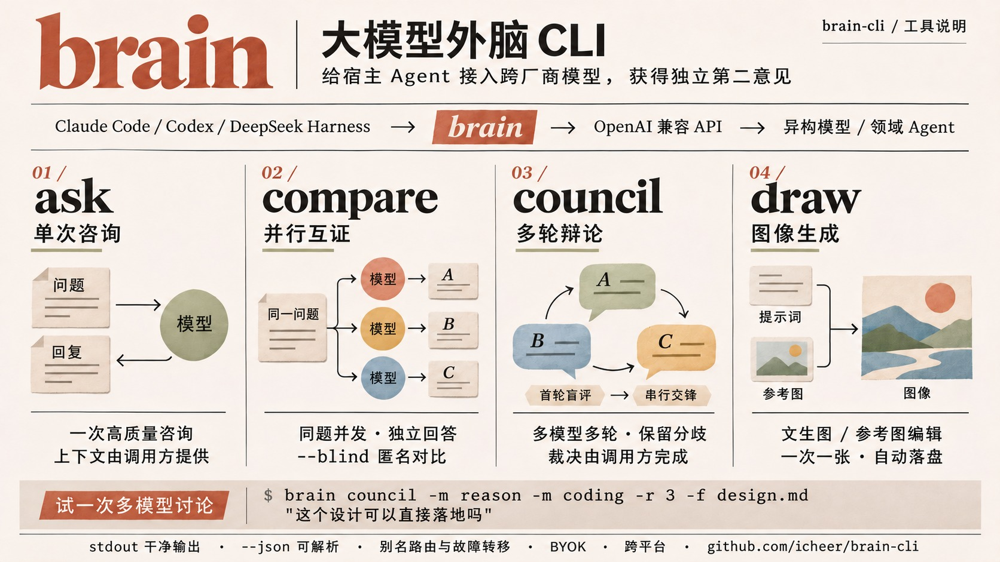

# brain-cli

[English](README.md) | **简体中文**

<p align="center">
  
</p>

> 仓库名 `brain-cli`，二进制命令名为 **`brain`**。

`brain` 是一个给宿主 Agent（Claude Code、Codex、DeepSeek Harness 等）当"外脑"的极简命令行工具：通过 OpenAI Chat Completions 兼容协议调用大模型网关，负责一次高质量的咨询/分析调用，把结果干净地交还给 Agent。同一个模型复核自己的结论，检不出自己的系统性偏差——brain 把跨厂商的异构模型作为独立第二意见接入宿主。

## 核心特性

- **Agent-Friendly**：stdout 只输出模型正文，元数据/警告/心跳全走 stderr；管道 / `-f` 多文件 / `-i` 图片多模态输入开箱即用；多来源输入自动以 XML 标签区隔（`<user_message>`/`<attachment>`/`<stdin>`），上下文边界明确不迷失
- **模型别名路由**：`fast` / `reason` / `coding` / `vision` 别名 + 自动故障转移（重试退避、换链上模型、stderr 提示），Agent 无需记忆模型名
- **并行交叉验证**：`brain compare -m a,b -m reason` 同题并发多模型，原文按 `===== model: X =====` 分隔头拼接（`--json` 为 `responses[]`）；compare 里别名=模型组快捷方式，每腿不做故障转移；`--blind` 输出匿名 Model_A/B 防裁决的品牌偏见
- **串行辩论 `brain council`**：N 个模型围绕同一议题多轮讨论——第 1 轮并行盲评（消灭首轮锚定），后续串行交锋、发言记录逐轮递增（后发言者可评价先发言者，末轮总结各方立场/变化/未解分歧；默认蛇形排布，`--order rotate|fixed` 可改）；立场视角无需专用语法，「席位-透镜表」写进上下文即是协议；席位只做同模型重试（中途换人=身份造假），缺席留标记，已积累发言不因提前终止/SIGINT 丢失
- **决策 `brain decide`**：System One 类型化判断——对一段 state 问一组是/否、单选、评分问题，返回概率与置信度（零散文），stdout 直接是可 jq 的 answers JSON；亚秒级、价格约为 chat 的 1/200。只做分类与打分（排阅读顺序、选调查入口、队列初分流），推理判断仍走 ask/council；协议仅 TypeSafe wire（`/v1/systemone`）事实标准；同模型重试不跨模型转移（概率校准基准不可换）；图片走 `--extra-body` 逃生口
- **图像生成 `brain draw`**：一次调用一张图、自动落盘。协议按模型名推断（含 `gemini` → Gemini 原生，其余 → OpenAI Images；`draw.type` 可覆盖）；可选 `draw:` 配置段缺省兜底既有 base_url/api_key；`--aspect`/`--res` 统一语义、按协议各自翻译；`-i` 参考图即进编辑模式；`--extra-body` 透传协议私有参数（grok 的 `aspect_ratio` 等；openai 顶层、gemini 并入 imageConfig）。stdout 恰一行保存路径，`--json` 照旧恒定单对象；图像按张计费，**不做自动重试**
- **可选推理深度与输出预算**：`-e low|medium|high|…`、`--max-output-tokens N` 纯透传（不设则各模型/网关默认；档位因模型而异，如智谱 GLM-5.3 仅 low/high/max）
- **通用透传口 `--extra-body` / `--extra-headers`**：任意请求体参数（temperature、response_format、厂商私有字段…）与 HTTP 头以 JSON 顶层 assign 透传（内联或 `@file`，可重复有序合并）；保留字拒绝防自毁，`--dry-run` 可核对合并结果；对齐 OpenAI SDK 的 extra_body/extra_headers
- **可解析**：退出码 0-7 / 130 全量语义；`--json` 成败恒定输出单对象（`jq` 无条件解析，`error.code` 与退出码一致）
- **健壮传输**：SSE 长连接（防中间层空闲断连）+ 流内错误事件识别（真实网关会以 HTTP 200 夹带 `data:{"error":…}` 回错）+ stderr 15s 心跳（本地进度显示，不产生网络流量）+ 总预算控制（重试也吃同一个 deadline）——在 one-api 系脏网关的真实行为上逐项实测，而非假设教科书式 HTTP
- **无状态**：多轮上下文由调用方拼接
- **中英双语界面**：按 `BRAIN_LANG` > `LC_ALL`/`LC_MESSAGES`/`LANG`（`zh*` → 中文，其他已设值 → 英文）> 时区兜底（UTC+8 → 中文）自动选择；随时 `BRAIN_LANG=zh|en` 强制
- **跨平台**：darwin / linux / windows × amd64 / arm64，goreleaser 发布，静态编译约 9MB

## 30 秒开始

### 一句话安装——把这段发给你的 Agent

```text
帮我安装 brain 技能：https://github.com/icheer/brain-cli
```

Agent 打开仓库后照做即可——下面这几步就是写给它的：

1. **放置技能目录**：把仓库 `skills/brain/` 整目录复制（或软链）到宿主技能目录——Claude Code 为 `~/.claude/skills/brain`（用户级）或项目内 `.claude/skills/brain`；其他宿主通常为 `.agents/skills/brain`
2. **安装二进制**：进入该目录运行 `bash install.sh`——从 Release 下载对应平台二进制到技能目录（SHA256 校验）；可加 `--link` 同时软链到 `/usr/local/bin` 供终端直用
3. **自检**：运行 `brain ping`。若未配置网关，`ping` 会失败并给出修复指引——此时请**用户自行在其终端**运行 `brain init`（交互向导）或 `brain config set` 完成配置：密钥由用户亲手键入、只落本机 0600 文件，不经过 Agent 对话（对话记录可能被留存）；不要替用户输入或索要明文密钥

二进制当前会话即可调用；技能本体下次会话生效。手动步骤见下。

`brain` 是 **BYOK**（Bring Your Own Key）工具：自身不提供模型服务，需要任意 **OpenAI 兼容 API** 的地址与密钥——不一定是"网关"，官方 API 直用即可，例如：

| 服务 | base_url |
| --- | --- |
| OpenAI 官方 | `https://api.openai.com/v1` |
| OpenRouter（多厂商聚合） | `https://openrouter.ai/api/v1` |
| DeepSeek | `https://api.deepseek.com/v1` |
| 智谱 | `https://open.bigmodel.cn/api/paas/v4` |

```bash
# 安装（三选一）
bash skills/brain/install.sh        # 技能场景：从 Release 下载二进制到技能目录（SHA256 校验）
                                    #   追加 --link 可同时软链到 /usr/local/bin（重装即全局升级）；
                                    #   追加 --global 则只装全局（目录不可写时自动 sudo）
# Windows：Git Bash（原生装 brain.exe，全局默认 ~/bin）或 WSL 下运行同一脚本
# 重跑 install.sh 即就地升级：自动识别既有安装形态（软链/全局/技能目录），
# 并从同一 Release 包同步 SKILL.md（v0.10.3 起）
# 卸载：bash skills/brain/install.sh --uninstall（移除全部已装二进制与全局链接，
#       幂等；配置文件与技能文档不动）
# 或从 https://github.com/icheer/brain-cli/releases 下载对应平台包
go install github.com/icheer/brain-cli@latest   # 开发者

# 配置（一次性；密钥只落本机 0600 文件，绝不进仓库）
brain init                                            # 交互向导，或下面三行：
brain config set base_url https://api.openai.com/v1   # 任意 OpenAI 兼容服务
brain config set api_key sk-xxxx
brain config set default_model gpt-5.6                # 可选；完整配置示例见 config.example.yaml

# 第一问
brain ping
brain ask -m fast "用一句话介绍你自己"   # -m 也可直接用模型 ID；-e low/medium/high… 可调推理深度（可选）
```

```bash
# 多模型交叉验证——裁决永远由你做（brain 不内建裁判）

# 并行：同题并发 N 个模型，原文按 ===== model: X ===== 分隔头拼接
brain compare -m reason -f report.md "这份报告的推理可靠吗"
brain compare -m reason -f report.md --json "这份报告的推理可靠吗" | jq -r '.responses[] | select(.ok) | .content'

# 串行辩论（council）：第 1 轮并行盲评，后续蛇形串行、发言记录递增——后发言者可评价
# 先发言者，末轮给出各方最终立场/观点变化/未解分歧。总调用 = 模型数 × 轮次。
brain council -m reason -m coding -f design.md "这个设计该用 SQLite 做存储吗"
# 立场/透镜就是上下文：用 -s 写席位-透镜表。每个模型发言时都会被告知自己的席位名
# （即 -m 展开后的完整模型 ID），它在表里认领写着自己名字的那一行——这就是全部映射。
# 唯一硬要求：表里要写展开后的模型 ID（-m panel 展开为链上 ID——席位从不知道别名，
# 写 panel=xxx 会全部认领失败且无报错）；ID 之外的写法（=、：、「从…视角」、列表）随意。
brain council -m panel -f design.md \
  -s "席位透镜：aihub/gpt-6-astra=安全与故障隔离；anti/gemini-3.8-flash=性能与交付速度" \
  "这个设计可以直接落地吗"
```

```bash
# 决策（System One 类型化判断；stdout = 可 jq 的 answers JSON）
brain config set decide.model jev-latest                # 一次性；TypeSafe wire /v1/systemone
brain decide --noul "is_urgent=是否表达紧迫性" "工单正文…"          # 是/否速记（可重复）
brain decide -Q '{"dept":{"type":"choice","criteria":{"billing":"计费","technical":"缺陷"}}}' "工单正文…"
brain decide --json --noul "q=x?" "state" | jq -r '.answers.q.noul'
# 只做分类与打分（排序/分流），不做需要推理的判断；类型化不免疫「合法格式的错误答案」
```

```bash
# 图像生成（自动落盘到当前目录；stdout = 保存路径）
brain config set draw.model gemini-3.1-flash-image   # 一次性；draw.base_url/api_key 可选（缺省兜底顶层）
brain draw --res 1K "a cute cat wearing a tiny knitted hat, watercolor style"
brain draw -i cat.jpg "把帽子换成红色"               # 参考图 → 编辑模式
brain draw -m grok-imagine-image-2.0 --extra-body '{"aspect_ratio":"16:9"}' "..."  # 协议私有参数透传
# --aspect 1:1|16:9|9:16|… 与 --res 1K|2K|4K 按协议各自翻译；图像按张计费，不做自动重试
```

给 Agent 用：把 `skills/brain/` 复制或链接进 `.claude/skills/`（或 `.agents/skills/`），SKILL.md 会引导宿主 Agent 何时、如何、何时不调用 brain。

## brain 与宿主 subagent 的区别

宿主 Agent 自带 subagent 机制（如 Claude Code 的 Task 工具）：同模型、带工具、独立上下文。brain 与它**互补而非替代**——最关键的一点是「换脑子」还是「再派一个自己」：

| 维度 | brain（外脑 CLI） | 宿主 subagent |
| --- | --- | --- |
| 模型 | 网关上任意外部模型（跨厂商——真·独立第二意见） | 与宿主同源（自我复核，系统性偏差与主线程相关） |
| 上下文 | 只看到你拼的 prompt（材料要自己贴/`-f` 带上） | 可自行读文件、跑命令探索仓库（适合大范围扫描） |
| 副作用 | 零——纯文本进出，无工具权限 | 继承宿主工具（读写文件、执行命令） |
| 契约 | 退出码 0-7/130、`--json`、超时/预算全部可编程 | 返回报告文本，生命周期由宿主托管 |
| 计费 | 走网关 key，`--json` 的 usage 逐次可见 | 走宿主订阅/API 账单，粒度取决于宿主 |

**各自的短板**：brain 看不到你的会话与仓库（喂料不全会答非所问），依赖网关可用性，跨厂商行为差异（推理档位、默认值）需要摸底；subagent 复核同源（同一个模型检查自己的结论，系统性偏差检不出来），并行多了 token 消耗放大。

**选型经验**：要「不同厂商模型对同一结论交叉验证 / 死循环破局」→ brain（多模型互证可一发 `brain compare`）；要「同模型并行做仓库级探索、汇总」→ subagent。两者可叠加：subagent 负责读材料，brain 负责跨模型裁决。

**「换脑子」不限于换模型——端点后面也可以是领域 agent**：信息采集、金融投研、事实核查、个人助理等细分领域，越来越多的独立 agent 以 OpenAI 兼容协议暴露端点，内部自带工具调用。对调用方而言这一切都是黑盒：传入相关上下文、拿回结果即可，远端如何推理、编排哪些工具无需关心。「不做 Function Calling」约束的只是 brain 自身（作为客户端不编排工具），从不限制端点背后是什么——正因契约只是纯文本进出，裸模型和完整 agent 都能无差别地享有同一套退出码 / `--json` / 别名 / 心跳约定。单份配置只指向一个 base_url，要混用多个端点可走聚合网关（OpenRouter / one-api 系），或用 `BRAIN_CONFIG` 指向另一份配置。

## 状态与路线

**:rocket: v0.12.1 已发布**（M0–M12）——里程碑与验收状态见 [DESIGN.md](DESIGN.md) 第 7 节。

| 里程碑 | 内容 | 状态 |
| --- | --- | --- |
| M0 (MVP) | 配置体系 + `ask`（参数/stdin/`-f`/`-i`/`-s`）+ 别名解析 + 退出码 + `brain models` | ✅ 完成 |
| M1 | SSE 传输 + 心跳 + fallback/重试 + `--json` + `brain ping` + 分发流水线 | ✅ 完成 |
| M2 | `--stream` / `--show-thinking` / `brain init` | ✅ 完成（Homebrew 待建 tap 仓库） |
| M3 | `-e` 推理深度透传 / `--json` 错误扩展（type/retryable/upstream_status/attempted_models）/ `--quiet` / `--dry-run` / `ping -m` 链探测 / `init` 别名生成 | ✅ 完成 |
| M4 | `--max-output-tokens` 输出预算透传 / `BRAIN_DEFAULT_MODEL` 环境变量 | ✅ 完成 |
| M5 | 配置单文件化：config.yaml + models.yaml 合并（breaking——别名进 aliases 段，`BRAIN_MODELS` 删除） | ✅ 完成 |
| M6 | 界面双语（zh/en）：locale / `BRAIN_LANG` / UTC+8 时区检测；README 中英双语 | ✅ 完成 |
| M7 | `brain compare` 并行独立采样（别名=模型组快捷方式、每腿无故障转移、≥1 成功即 exit 0）/ `--blind` 匿名盲测 | ✅ 完成 |
| M8 | `--extra-body` / `--extra-headers` 通用透传口（JSON 顶层 assign、保留字拒绝、`@file`、`--dry-run` 可见） | ✅ 完成 |
| M9 | `brain council` 串行辩论（首轮并行盲评+蛇形串行交锋、透镜=上下文、缺席退出、沉没成本保护）；v0.10.x 增补：`--order snake/rotate/fixed` 发言顺序策略、轮次短旗标 `-C`→`-r`（breaking） | ✅ 完成 |
| M10 | 多来源输入 XML 区隔（`<user_message>`/`<attachment>`/`<stdin>` 标签 + 数据非指令 system 声明）；安装器线：Windows Git Bash 原生适配、形态检测就地升级 + SKILL.md/安装器随包同步、`--uninstall` 卸载；v0.11.3 增补：不可信内容保留字转义（杜绝伪造标签边界/假发言记录）、`<attachment id>` 序号援引 | ✅ 完成 |
| M11 | `brain draw` 图像生成（双协议 Gemini 原生 / OpenAI Images 按名推断 + `draw.type` 覆盖、draw 配置段兜底顶层、`--aspect`/`--res` 统一语义、`-i` 参考图、自动落盘 + stdout 路径）；v0.11.4 增补：`--extra-body`/`--extra-headers` 透传（openai 顶层、gemini 并入 imageConfig——grok 类私有参数） | ✅ 完成 |
| M12 | `brain decide` 决策原语（System One 类型化判断——是/否、单选、评分带概率；仅 TypeSafe wire `/v1/systemone`、state 走 ask 同款装配 + `-Q`/`--noul` 问题通道、stdout 直出 answers JSON、`--json` 外壳、同模型重试、图片走逃生口） | ✅ 完成 |

## 灵感来源

`brain` 的核心方法论——同一个问题发给多个异构模型，互为第二意见、交叉验证——来自黄仁勋（Jensen Huang）分享的日常用法：

> "This is no different than getting three opinions. Three doctors' opinions. I do the same thing. I ask the same question of multiple AIs. And I ask them to compare each other's notes and then give me the best of all the answers. And so I think that process of critiquing, criticizing the answers enhances cognitive skills."
>
> 「这与征求三种意见没有区别——三位医生的意见。我做的是同样的事：向多个 AI 提出同一个问题，让它们互相比较彼此的回答，然后给我所有答案里最好的那个。而我认为，这种批判、点评答案的过程，本身就在增强认知能力。」
>
> —— 黄仁勋，CNN《Fareed Zakaria GPS》访谈，2025-07-13（[CNN](https://www.cnn.com/2025/07/13/world/video/gps0713-nvidia-us-china-ai) · [报道](https://www.businessinsider.com/ai-will-redefine-jobs-not-replace-them-nvidia-ceo-huang-2025-7)）

同月在北京链博会上被问到「是否使用 DeepSeek」时，他点名自己几乎同时使用 OpenAI、Gemini Pro、Claude 与 Perplexity 四个工具，并称多 AI 互证未来会成为一种安全机制——很多不同的 AI 之间形成冗余、平衡与交叉验证。

`brain compare`（同题并发互证）与 `brain council`（串行交锋、逐轮互评）就是把这套做法工程化为一条命令：跨厂商接入真正独立的模型，裁决永远由你做。

> 作者也谨在此向黄仁勋本人致以个人的敬意与支持。从 Denny's 餐馆的一张餐桌起步，他把一家游戏显卡公司带到了 AI 时代的中心；近来纵有风波，瑕不掩瑜——他对技术的诚实、对开发社区的慷慨，以及换下皮衣、身着唐装站上北京舞台时对中国展现的尊重与善意，始终散发着人格的光辉。愿他继续把 AI 带向普惠。
>
> —— icheer，2026-11

## 友情社区

- [LINUX DO (`linux.do`)](https://linux.do/) — 新的理想型社区
- [V2EX (`v2ex.com`)](https://www.v2ex.com/) — Way to explore.

## 许可证

MIT — 见 [LICENSE](LICENSE)。
